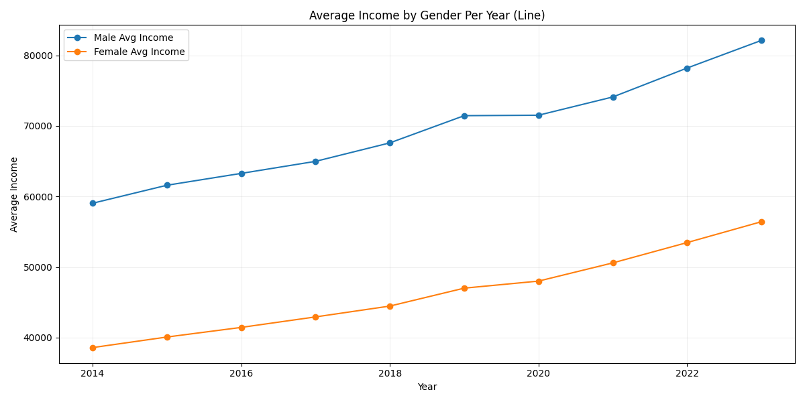
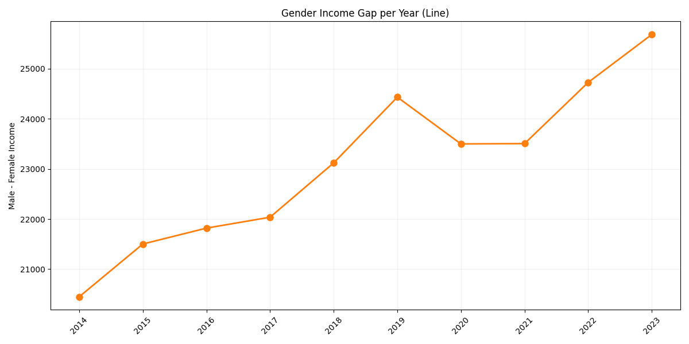
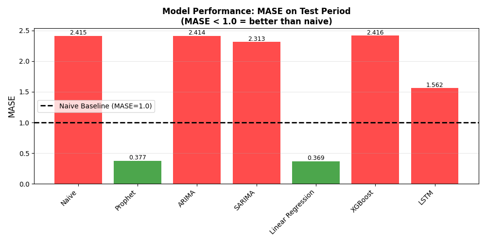
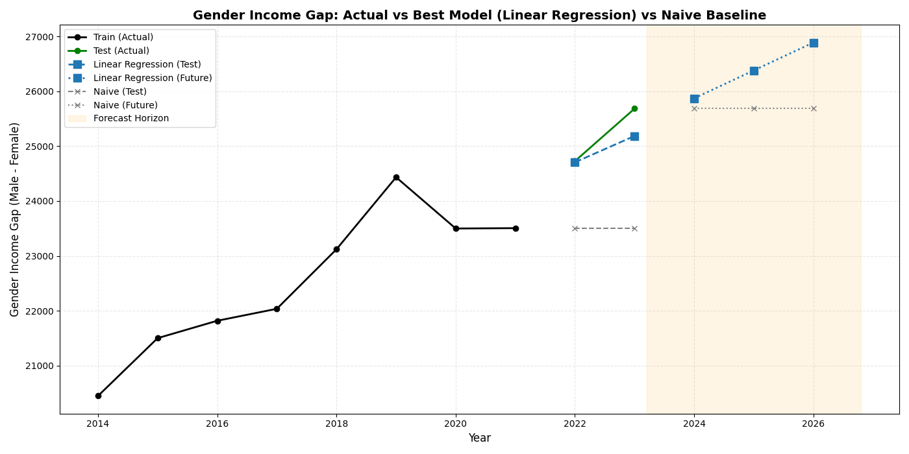
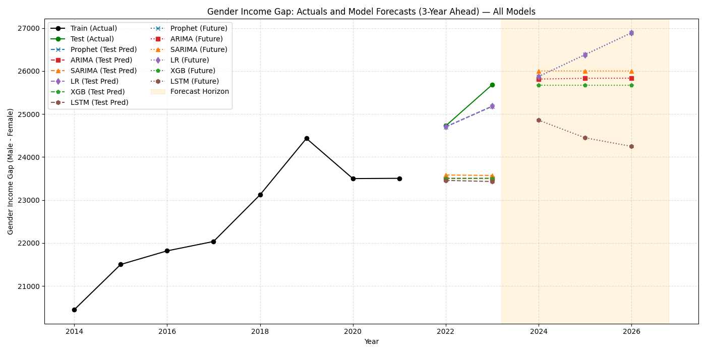

# Forecasting the Gender Income Gap in the United States

Time series forecasting analysis of the gender income gap using microdata from the U.S. Census Bureau's American Community Survey (ACS) Public Use Microdata Sample (PUMS), 2014–2023.

## Research Objective

This project examines past income data and predicts future trends in the gender income gap in the United States. Average yearly incomes for men and women are calculated from ACS PUMS microdata, and the difference between them is analyzed as a time series. Multiple forecasting models are compared, and their performance is evaluated using Mean Absolute Scaled Error (MASE).

## Key Results

### Average Income by Gender (2014–2023)

<p align="center">
  
</p>

### Gender Income Gap Trend

<p align="center">
  
</p>

### Model Performance Comparison (MASE)

<p align="center">
  
</p>

Linear Regression and Prophet are the only models that outperform the naive baseline (MASE < 1.0), with Linear Regression achieving the lowest error.

### Best Model Forecast (2024–2026)

<p align="center">
  
</p>

### All Models Comparison

<p align="center">
  
</p>

## Data Source

**American Community Survey (ACS) 1-Year Public Use Microdata Sample (PUMS)**

- **Years:** 2014–2023
- **Publisher:** U.S. Census Bureau
- **Files used:** `psam_pusa_{year}.csv` and `psam_pusb_{year}.csv` for each year (person-level records, parts A and B)
- **Variables:** `SEX`, `PINCP` (personal income), `AGEP` (age), `ST` (state), `WKHP` (hours worked per week), `COW` (class of worker), `SCHL` (education level), `OCCP` (occupation)

> **Citation:** U.S. Census Bureau. (2014–2023). *American Community Survey 1-Year Public Use Microdata Sample (PUMS), 2014–2023* [Data set]. U.S. Department of Commerce. https://www.census.gov/programs-surveys/acs/microdata.html

> **Disclaimer:** This product uses data from the U.S. Census Bureau American Community Survey (ACS) Public Use Microdata Sample (PUMS), but is not endorsed or certified by the U.S. Census Bureau. All analyses, calculations, and derived conclusions are solely those of the author(s).

> **Note on 2020 data:** Due to COVID-19 pandemic non-response disruptions, the Census Bureau released an experimental 1-year PUMS dataset for 2020 using entropy-balanced weights. The Census Bureau cautions against directly comparing 2020 1-year estimates with other years in multi-year time series.

## Repository Structure

```
├── clean_data.py          # Step 1: Clean and merge raw PUMS CSVs → cleaned_dataset.csv
├── forecast_model.py      # Step 2: Analysis, modeling, evaluation, and visualization
├── figures/               # Output figures (PNG) generated by forecast_model.py
├── requirements.txt       # Python package dependencies
├── .gitignore             # Excludes large data files from version control
└── README.md              # This file
```

**Not tracked in Git** (generated locally):
- `dataset/` — Raw ACS PUMS CSV files (~1–1.5 GB each, ~24 GB total)
- `cleaned_dataset.csv` — Processed dataset (~1.1 GB), output of `clean_data.py`

## Setup

### 1. Python Environment

Requires **Python 3.10+**. Install dependencies:

```bash
pip install -r requirements.txt
```

### 2. Obtain the Raw Data

Download ACS PUMS 1-Year person-level CSV files for 2014–2023 from the Census Bureau FTP archive:

https://www2.census.gov/programs-surveys/acs/data/pums/

For each year, download the 1-Year CSV ZIP from the corresponding year directory (e.g., `2014/1-Year/csv_pus.zip`), extract it, and place the person-level files into a `dataset/` directory at the repository root:

```
dataset/
├── psam_pusa_2014.csv
├── psam_pusb_2014.csv
├── psam_pusa_2015.csv
├── psam_pusb_2015.csv
│   ...
├── psam_pusa_2023.csv
└── psam_pusb_2023.csv
```

### 3. Run the Pipeline

**Step 1 — Clean and merge the raw data:**

```bash
python clean_data.py
```

Reads all 20 raw CSV files from `dataset/`, applies cleaning (column standardization, filtering for positive income, missing value handling, label encoding), and writes `cleaned_dataset.csv` (~1.1 GB) to the project root.

**Step 2 — Run the forecasting analysis:**

```bash
python forecast_model.py
```

Reads `cleaned_dataset.csv` and performs:
1. Demographic analysis and exploratory visualization
2. Welch's t-test for income difference significance
3. Time series preparation (gender income gap = male mean − female mean, per year)
4. Chronological train/test split (last 2 years held out)
5. Model fitting: Prophet, ARIMA(1,1,0), SARIMA(1,1,1), Linear Regression, XGBoost (lag features), LSTM
6. Performance evaluation (MAE, RMSE, MAPE, MASE) with model ranking
7. Residual diagnostics and Ljung-Box tests
8. Refitting on full data and 3-year-ahead forecasting (2024–2026) with prediction intervals
9. Expanding-window cross-validation for robustness
10. Visualizations displayed interactively via `plt.show()`

## Models and Evaluation

| Model | Description |
|-------|-------------|
| **Naive** | Baseline — last observed value repeated |
| **Prophet** | Facebook's time series decomposition model |
| **ARIMA(1,1,0)** | Autoregressive Integrated Moving Average |
| **SARIMA(1,1,1)** | Seasonal ARIMA via SARIMAX |
| **Linear Regression** | Simple linear trend on time index |
| **XGBoost** | Gradient boosting with lag-1, lag-2, lag-3 features |
| **LSTM** | Long Short-Term Memory neural network (3 lags, 32 units) |

**Primary metric:** MASE (Mean Absolute Scaled Error) — scale-free, compares against naive baseline. MASE < 1.0 indicates the model outperforms naive forecasting.

## All Output Figures

| File | Description |
|------|-------------|
| `average_income_per_gender.png` | Grouped bar chart of mean income by gender per year |
| `average_income_per_gender_line.png` | Line chart of mean income trends by gender |
| `income_gap.png` | Gender income gap bar chart |
| `income_gap_line.png` | Gender income gap trend line |
| `income_distribution_per_gender_boxplot.png` | Income distribution boxplot by gender |
| `demographic_gender.png` | Gender count distribution per year |
| `demographic_gender_proportion_per_year.png` | Gender proportion stacked bar chart |
| `linear_regression.png` | Linear Regression forecast plot |
| `arima.png` | ARIMA forecast plot |
| `sarima.png` | SARIMA forecast plot |
| `prophet.png` | Prophet forecast plot |
| `xg_boost.png` | XGBoost forecast plot |
| `lstm.png` | LSTM forecast plot |
| `all_models.png` | All models combined comparison |
| `best_model.png` | Best model vs. naive baseline |
| `MASE.png` | MASE performance comparison bar chart |
| `MAPE_accuracy.png` | MAPE accuracy comparison |
| `rolling_window.png` | Expanding-window validation results |
| `ARIMA_residuals.png` | ARIMA residual diagnostics |
| `SARIMA_residuals.png` | SARIMA residual diagnostics |
| `Prophet_residuals.png` | Prophet residual diagnostics |
| `linear_regression_residual.png` | Linear Regression residual diagnostics |
| `prediction_errors.png` | Test-period prediction errors |

## Limitations and Reproducibility Notes

- **LSTM and XGBoost** results may vary slightly across runs due to random weight initialization and stochastic training. Set random seeds for exact reproducibility.
- **Small time series** (10 annual data points) limits the reliability of complex models, which is consistent with the finding that Linear Regression performs best.
- The script uses `plt.show()` for interactive figure display; figures in `figures/` were saved separately.
- The **2020 data** may reflect pandemic-related disruption in ACS collection methodology (reduced sample size and experimental weighting); this is not adjusted for in the current analysis.
- All models are refitted on the complete dataset before generating future forecasts.

## License

ACS PUMS data is in the **public domain** as a product of the U.S. federal government (17 U.S.C. § 105) and is not subject to domestic copyright restrictions.
